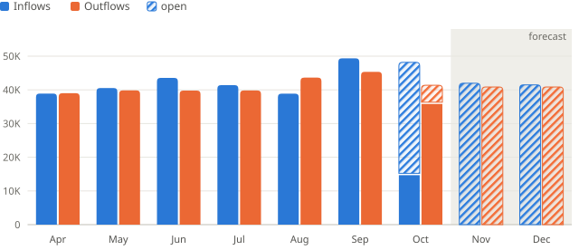
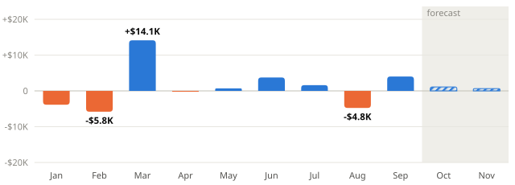
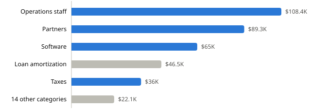
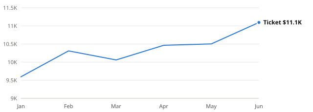
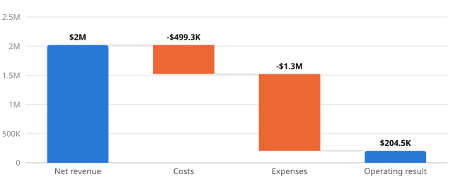
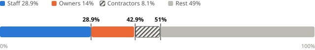

# bareink

**Charts that tell the bare truth, in 7 KB.**

Describe what your numbers *mean*: a volume per month, a level over time, parts of a whole. `bareink` decides how to show them (which chart, or no chart at all), says why, and draws the result as a plain SVG string. Zero runtime dependencies, no DOM, under 0.1 ms per chart.

```js
import { render } from 'bareink'
import { en } from 'bareink/locale/en'

const { form, code, reason, markup } = render({
  title: 'Inflows and outflows move together',
  dimension: { key: 'month', label: 'Month', kind: 'time' },
  measures: [
    { key: 'in', label: 'Inflows', unit: 'currency', nature: 'flow' },
    { key: 'out', label: 'Outflows', unit: 'currency', nature: 'flow' },
  ],
  rows: [
    { month: 'Apr', in: 38900, out: 39000 },
    { month: 'May', in: 40540, out: 39850 },
    { month: 'Jun', in: 43540, out: 39790 },
  ],
}, { width: 640, messages: en })

form    // 'columns'
code    // 'volume-trend'
reason  // 'A volume per period: columns from zero.'
markup  // '<svg ...>'
```

## Why

Most chart libraries draw whatever you ask for. When the one asking is an LLM, or someone in a hurry, that means pies with slices nobody can compare, dual axes that invent a relationship, and two columns posing as a trend.

`bareink` turns that around: **a deterministic router picks the form, says why, and is allowed to say no.**

## Showcase

Every chart below is a plain SVG string from `render()`, written to a file by [`examples/readme.ts`](examples/readme.ts). No browser was involved.

<!-- showcase:start -->
<picture>
  <source media="(prefers-color-scheme: dark)" srcset="docs/img/columns-dark.svg">
  
</picture>

**`columns`**: A volume per period: columns from zero.

<picture>
  <source media="(prefers-color-scheme: dark)" srcset="docs/img/diverging-dark.svg">
  
</picture>

**`diverging`**: Values below zero over time: the sign matters as much as the size.

<picture>
  <source media="(prefers-color-scheme: dark)" srcset="docs/img/bars-dark.svg">
  
</picture>

**`bars`**: Categories: bars, largest first.

<picture>
  <source media="(prefers-color-scheme: dark)" srcset="docs/img/line-dark.svg">
  
</picture>

**`line`**: A level over time: line.

<picture>
  <source media="(prefers-color-scheme: dark)" srcset="docs/img/waterfall-dark.svg">
  
</picture>

**`waterfall`**: Steps from a total to a result: waterfall.

<picture>
  <source media="(prefers-color-scheme: dark)" srcset="docs/img/share-dark.svg">
  
</picture>

**`share`**: Up to 3 parts of a whole: one 0–100% bar, never a pie.

### When the router says no

| Asked for | Router says |
|---|---|
| September vs October | **table**: Under 3 periods show no trend: table. |
| Revenue and customers | **table**: Different units would need two axes: table. |
| Three offices cost the same | **table**: Nearly equal values would draw equal bars: table. |
| Yearly site renewals | **table**: A list of items, not a series: table. |
| Cash today | **kpi**: One row: numbers read better as cards. |
<!-- showcase:end -->

## The rules

They are not configurable. That is the point.

- **The meaning picks the form.** Columns for a volume per period, horizontal bars for categories, a line for a level, diverging columns when values go below zero, a waterfall for stages, one 0–100% bar for up to 3 parts of a whole.
- **Never a pie. Never a dual axis.**
- **Honest scales.** Columns and bars start at zero. A line leaves zero only when the range exceeds 10% of the value, and the chart says so in a note.
- **Nothing disappears, nothing is invented.** Values below zero are drawn below zero, or the router picks a table. A missing value is a gap in a line or an empty slot in columns, never a zero; in categories, stages and shares it makes a table. Long labels are shortened on screen and kept whole in the tooltip.
- **Forecast looks different.** Actuals are solid; forecast and open amounts are hatched in columns and dashed in lines.
- **Few series.** Up to 3 per chart, named in a legend when color carries meaning.
- **When in doubt, a table.** One row becomes number cards. Two periods, mixed units, near-equal values, sums over 100% and lists of records become a table.
- **Accessible by default.** `role="img"` with the title as its name, a native `<title>` tooltip on every mark, and a table for every chart through `renderTable`.

### What the router decides

| Code | Form | When |
|---|---|---|
| `volume-trend` | columns | A flow over 3 to 18 periods |
| `level-trend` | line | A level over time, or more than 18 periods |
| `signed-mixed` | diverging | One series over time with values below zero |
| `category-rank` / `category-top` | bars | One measure across categories (top 8, rest grouped) |
| `flow-stages` | waterfall | `dimension.kind: 'stage'` |
| `share-few` / `share-many` | share / bars | Percent parts of a whole, up to 3 / more than 3 |
| `single-row` | kpi | One row |
| `too-few-periods`, `mixed-units`, `too-many-series`, `negative-series`, `category-multi`, `category-negative`, `category-flat`, `not-a-whole`, `missing-values`, `record-list`, `empty`, `fallback` | table | Everything a chart would distort |

`code` is stable across versions; build on it. `reason` is the human sentence for that code, present only when you pass a locale.

## API

```ts
import { render, renderTable, route, cssVariables, light, dark } from 'bareink'
import { validate } from 'bareink/validate'
import { en } from 'bareink/locale/en'        // or { ptBR } from 'bareink/locale/pt-BR'

route(dataset, messages?)          // { form, code, reason }: the decision only, 0.7 KB
render(dataset, options?)          // { form, code, reason, markup, notes }
renderTable(dataset, options?)     // an HTML table, the fallback for any chart
validate(dataset)                  // string[]: readable errors, empty when valid
cssVariables(palette, selector?)   // CSS custom properties for a theme
```

Options: `width` (default 640), `locale` and `currency` (passed to `Intl.NumberFormat`), `messages` (a locale), `palette`, `inlineColors`, `id` (prefix for the hatch patterns; set it when one page shows charts with different inline palettes).

`render` trusts its input; call `validate` first when the dataset comes from a user or a model.

### The dataset

The full contract, with descriptions written for language models, is [`schema.json`](schema.json) (also exported as `bareink/schema.json`).

| Field | Meaning |
|---|---|
| `title` | The takeaway as a sentence; the chart's accessible name |
| `dimension.kind` | `time` (ordered periods), `category`, `stage` (steps from a total to a result), `record` (a list of items) |
| `measures[].unit` | `currency`, `percent` (0–100), `count`, `number`, `text` |
| `measures[].nature` | `flow` (happens during the period: revenue, inflows), `level` (read at a point in time: balance, price), `signed` (the sign is the point: net result) |
| `measures[].openKey` | key of an amount still open, hatched on top |
| `partOfWhole` | the rows are percent parts of one whole (`unit: 'percent'`) |
| `forecastFrom` | index of the first forecast row |
| `reference` | a reference line; `alertAbove` colors bars that cross it |
| `highlight`, `muted`, `uncertain`, `totalRows` | row indexes for direct labels, grey bars, hatched parts, waterfall totals |

Dates are never parsed: dimension values are the labels you pass. Use `null` for a missing value, never 0.

## With a language model

Give the model `schema.json` as the input schema of a tool, and let your app do the drawing:

```js
import schema from 'bareink/schema.json' with { type: 'json' }
import { render } from 'bareink'
import { validate } from 'bareink/validate'

const tool = {
  name: 'show_chart',
  description: 'Show numbers to the user. Describe what the numbers mean; the chart type is chosen for you, and may be a table.',
  input_schema: schema,
}

function onToolCall(input) {
  const errors = validate(input)
  if (errors.length) return { error: errors.join('\n') }   // the model fixes its call
  const { code, markup } = render(input, { width: 640 })
  show(markup)
  return { shown: code }                                     // the model explains the choice in the user's language
}
```

Two habits keep it honest and cheap:

- When the numbers come from your own query, let the model describe the envelope (title, dimension, measures) and fill `rows` from the query result yourself. The model never retypes data.
- Return `code`, not `reason`. The model already speaks the user's language and can say why a table was shown.

## In the browser, from a CDN

```html
<script src="https://cdn.jsdelivr.net/npm/bareink@0.1.0/dist/bareink.iife.js"></script>
<script>
  document.querySelector('#chart').innerHTML = bareink.render(dataset, { messages: bareink.en }).markup
</script>
```

The IIFE build includes `validate`, `en` and `ptBR`.

## Theming

Colors are CSS custom properties with fallbacks (`var(--bi-s1,#2a78d6)`), so a page sets its theme in CSS and dark mode comes for free:

```js
import { cssVariables, dark } from 'bareink'
const css = `@media (prefers-color-scheme: dark) { ${cssVariables(dark)} }`
```

Where CSS variables are not available (PDF, rasterizers, images in a README), pass `inlineColors: true`.

## Size

| Entry | min | gzip | brotli |
|---|---|---|---|
| `bareink` (`render`, `renderTable`) | 15.4 KB | 7.0 KB | 6.4 KB |
| `bareink/route` | 1.5 KB | 0.7 KB | 0.6 KB |
| `bareink/validate` | 3.4 KB | 1.5 KB | 1.3 KB |
| `bareink/locale/en` | 1.4 KB | 0.7 KB | 0.5 KB |
| `bareink/locale/pt-BR` | 1.5 KB | 0.7 KB | 0.7 KB |

Measured with esbuild, minified, ES2020. CI fails when `render` or `route` grow past the budget in [`size-budget.json`](size-budget.json).

## Compatibility

ESM with types, plus an IIFE for CDNs. ES2020, no DOM, no dependencies. Tested on Node 20.19, 22 and 24, Deno and Bun. Labels are escaped, so user or model text cannot inject markup.

## License

MIT
